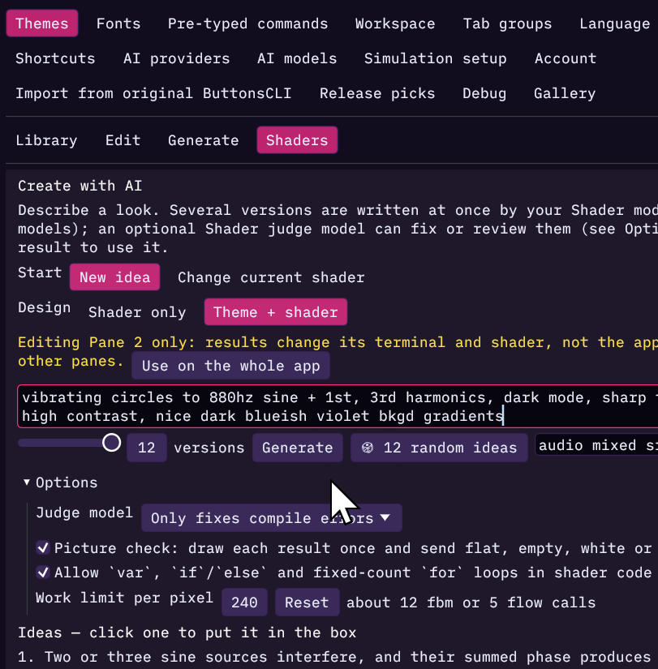

# AI themes

The best way to get an AI-made theme is on the Shaders tab. **Create with AI**
writes up to 12 complete looks from one description: app colors, the 16
terminal colors, the background gradient, fonts and a matching animated
background.

You need a **Theme generation model** and a **Shader generation model**
[set up](ai-setup.md); the main model covers both.

## Make one

1. Open **Settings → Themes → Shaders** and find **Create with AI**.
2. Next to **Design**, make sure **Theme + shader** is picked. With **Shader
   only** you get a background and your theme stays as it is.
3. Describe it: *a cozy autumn cabin at dusk*, *high-contrast neon for late
   night work*, *make the app look like Halloween*.
4. Set **versions** and click **Generate**.
5. Click **Use this one** under the look you like, then save it. Colors, fonts
   and shader are kept together in one theme file.

[AI shaders](ai-shaders.md#theme--shader) explains the steps, the checks and
what happens when you edit a single pane.

Want the theme without motion? Lower **Strength** on the Shaders tab, or switch
the shader off: the colors and fonts stay.

## The Generate tab

**Settings → Themes → Generate** is the older way. It writes one theme at a
time, with no shader:

1. Describe the theme.
2. Optional: tick **Allow installed and custom fonts (less portable)** to let
   it pick fonts from your system, not only the bundled ones.
3. Click **Generate theme**. It takes about 20–30 seconds; **Cancel
   generation** stops it.

The theme previews on your terminals straight away (or on the pane picked
under **Edit for**). Then choose:

| Button | Does |
| --- | --- |
| **Save as theme** | Saves it as a new personal theme. Never overwrites one you have. |
| **Edit in theme library** | Opens it in the Edit tab to adjust colors first. |
| **Discard candidate** | Throws it away and puts your previous look back. |

Unsaved edits are saved first as a numbered copy, so nothing is lost.

## Checks

Every theme is checked before you see it: its shape, the contrast of text
against backgrounds, and that the fonts exist. A theme that fails goes back to
the model once with the reason. Bad themes are never applied.

## What is sent

Your description, the current theme's palette, and the font names it may use.
Terminal contents and keys are never sent.
