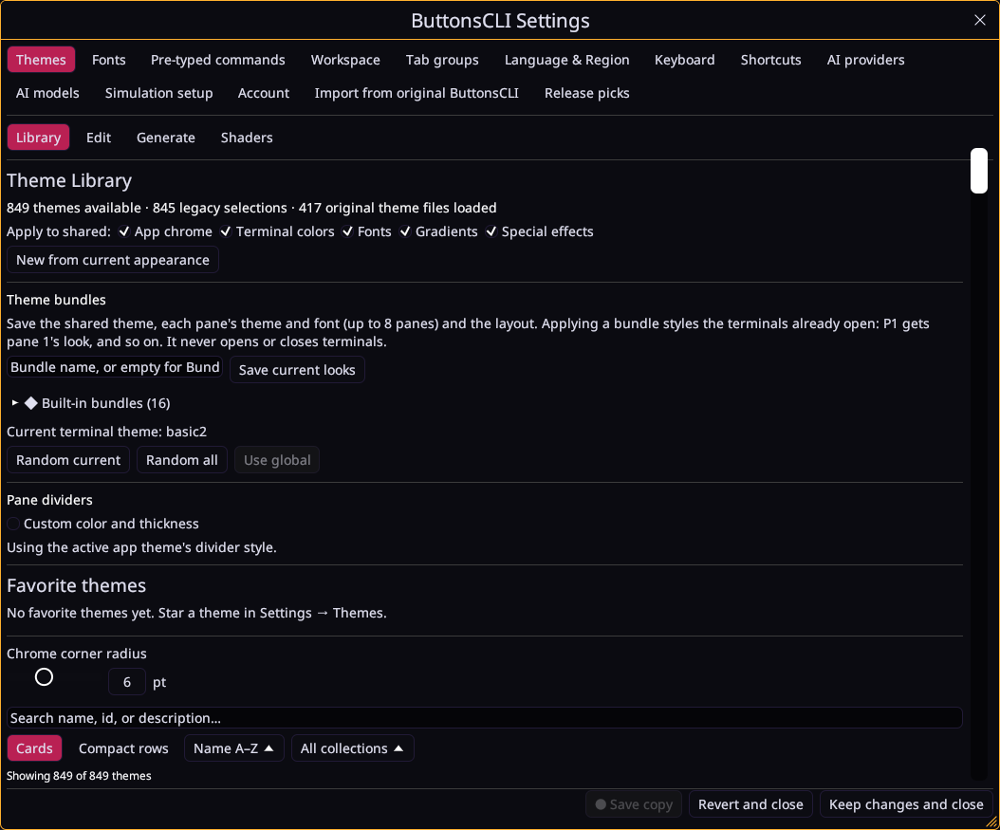
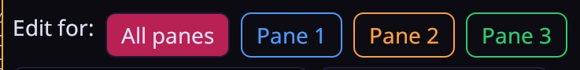
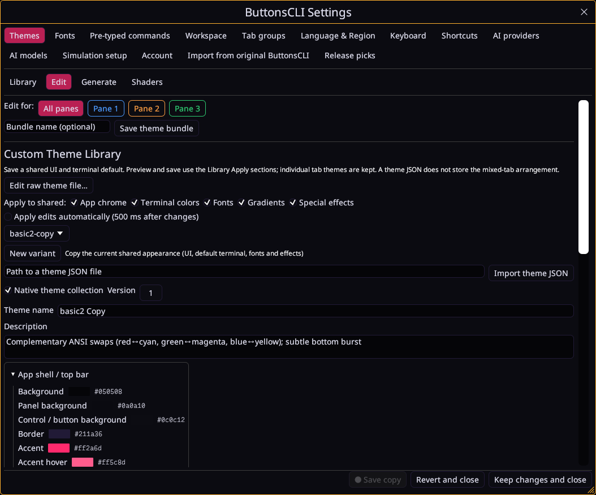
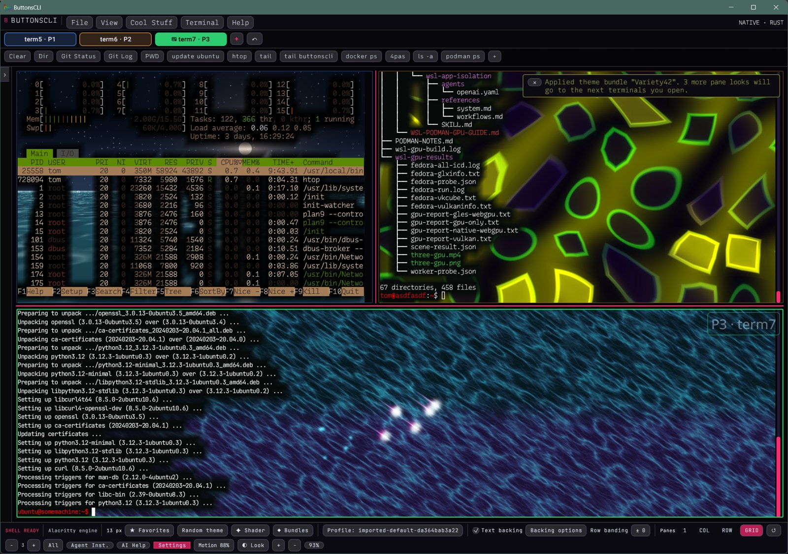
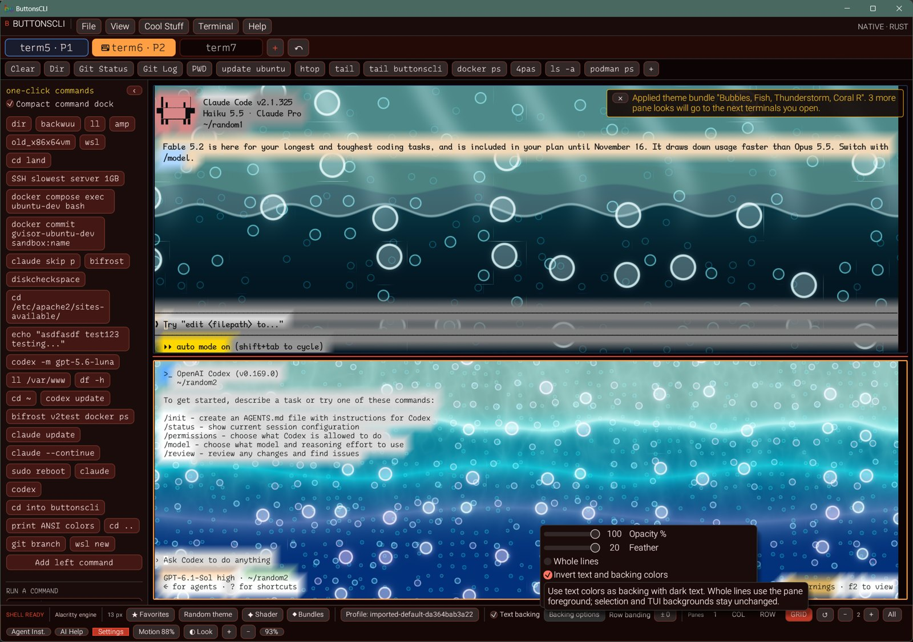

# Themes

A theme sets the app's colors, the terminal's colors, fonts, the background
gradient and special effects (scanlines, noise, shaders). There are hundreds
built in, and you can make your own.

Open **Settings → Themes**. It has four tabs:

| Tab | For |
| --- | --- |
| **Library** | Browsing and applying themes, favorites, theme bundles |
| **Edit** | Changing colors, gradients and effects of a theme |
| **Generate** | Making one theme from a description with AI; Shaders → Create with AI makes several, each with a background ([AI themes](ai-themes.md)) |
| **Shaders** | The animated background ([Shader backgrounds](shaders.md)) |

<!-- IMAGE: theme-library.png — Library tab with search, favorites row and Apply to shared checkboxes. | alt: Settings, Themes, Library: Apply to shared checkboxes, theme bundles, favorites and the theme search -->

## Whole app or one pane

Each theme card in the Library has four buttons:

- **Apply**: the whole app, for the parts ticked under **Apply to shared**.
  With Terminal colors ticked, every pane shows it, including panes that had
  a theme of their own.
- **Calm**: the same as Apply, and turns on Calm (see below).
- **This terminal**: only the active pane.
- **All terminals**: every pane, but the app's own colors stay as they are.

An unsaved edit of one pane is never lost: it is saved as a new numbered
theme first.

- **One pane**: right-click a pane → **Random theme** or a favorite, or use
  **Edit for: Pane N** (below). That pane keeps its look while the shared
  theme changes.
- **Use global theme** on a pane's menu removes its own theme again.

### Apply to shared

Above the list, **Apply to shared** decides which parts of a theme you take:
**App chrome**, **Terminal colors**, **Fonts**, **Gradients** and
**Special effects**. Untick Fonts, for example, to try color themes without
losing your font setup. Shaders count as Special effects.

## Favorites and random

Click the star next to a theme to favorite it. Favorites appear at the top of
the Library and in the status bar's **Favorite themes** menu. **Random theme**
picks one you are not already using.

## Shuffle

**◐ Look → Shuffle** in the status bar changes the theme by itself, with the
colors fading into the next theme's:

- **Change theme every N min** turns it on; **Next** changes now.
- **From**: favorite themes, my themes (yours, including saved AI results),
  themes with a shader (the default) or all themes. Each theme comes once, in
  random order, before any repeats.
- **Fade seconds**: how long the change takes (0 switches at once). Colors
  blend; a different shader fades out and the new one fades in.
- **A different theme in each pane** gives every pane its own pick. Panes
  keep their last pick when Shuffle stops.
- **Shaders only** changes just the shared shader and keeps your colors.
  Panes with a theme of their own keep their own shader.
- **Fonts too** also takes each theme's fonts. Off by default: a font change
  resizes the terminals. Panes you zoomed keep their size.

Shuffle applies themes the way **Random theme** does, so panes with their own
theme follow the shared one again (unless it gives each pane its own). It
never edits or saves a theme file. It
waits while Settings is open and while the window is minimized. A **Theme +
shader** result from Create with AI is one theme, so its colors, fonts and
shader always come together.

## Edit for: All panes / Pane 1 / Pane 2…

When two or more panes are on screen, the Edit and Shaders tabs show an
**Edit for** row:

- **All panes** edits the shared theme.
- **Pane N** edits only that pane. Clicking a terminal also switches which
  pane you are editing.

Switching panes never asks you to save: unfinished edits are saved as a new,
numbered personal theme (for example *Ember Veil 2*), so nothing is lost and
no other pane's theme is overwritten.

When your edits won't reach the whole app (you are editing one pane, or
panes on screen have a theme of their own), the Shaders tab says so next to
Create with AI and **Keep it**. **Use on the whole app** then saves the
pane's edit and uses it for the app colors and every pane, or, from **All
panes**, makes every pane use the shared theme again.

<!-- IMAGE: edit-for-row.png — the Edit for row with Pane 1–3 chips in their pane colors. | alt: The Edit for row: All panes, then Pane 1, Pane 2 and Pane 3, each in its pane color -->

## Making your own theme

- **New from current appearance** (Library) captures what you see now.
- In **Edit**, **New variant** starts a copy of the current theme; saving
  writes a personal theme file.
- **Edit raw theme file…** opens the JSON if you like editing text.
- Themes import and export as `.json` files, so you can share them.

<!-- IMAGE: theme-editor.png — Edit tab with the ANSI palette and gradient controls. | alt: Settings, Themes, Edit: the Edit for row, the theme picker and the first color groups of the theme editor -->

## Fonts

**Settings → Fonts** sets fonts separately for the terminal, tabs, docks and
the rest of the UI. A pane can also have its own terminal font. Bundled fonts
work offline; you can import TTF/OTF files too.

## Text backing: text you can always read

Busy shaders can make text hard to read. **Text backing** in the status bar
puts a soft panel behind the text in every pane, so the text is readable over
any shader, gradient or picture, while the shader stays visible around it.
That is its main job; it also happens to look good. **Backing options** next
to it:

- **Readable: White on black** puts a solid black panel behind every line of
  text and draws the text white, in every pane, over anything. **Black on
  white** does the opposite (it works even if you dislike light themes: only
  the text panels are light). **Theme colors** goes back to each pane's own
  colors.
- **Opacity %** and **Feather** (how soft the edges are, up to 30). 100% and
  20 is a good start.
- **Whole lines** backs each line edge to edge instead of only the words.
- **Invert text and backing colors** uses the text colors as the panel and
  draws the text dark, for very bright shaders. Selections and TUI
  backgrounds keep their own colors.
- **Auto contrast** keeps every letter readable on its own: any text that is
  too close in brightness to what is behind it is moved toward white or black
  until it reaches **Minimum contrast** (see below). Text that is already
  readable is left alone. It works with backing off too.
- **Backing and text colors…** opens a small window. **Own text color** draws
  text on the default background in one color instead of the theme's (tick
  **Colored text too** to also replace colored output such as errors or file
  types). Tick **Custom colors for all panes** to swap the pane colors for
  your own: up to
  eight colors (**+** adds one, **×** removes one), or a preset (Rainbow,
  Sunset, Ocean, Fade to black, Black, White, the theme's colors). **Also in
  panes whose theme has its own** makes them win everywhere. **Layout** picks how they
  are used:
  - **Gradient top to bottom** or **left to right** across the pane.
  - **One color per line**, cycling.
  - **Outline rings**: each color is a ring around the text, the first one
    innermost. With **Follow letter shapes** ticked the rings trace the
    letters themselves, like an outline drawn by hand; unticked, they go
    around a box behind each run of text (lighter work for very large or
    fast-scrolling panes). **Ring width** sets how thick.
    **Blend %** fades each ring into the next: 100 makes one smooth gradient
    around the text (red then yellow passes through orange), 0 gives hard
    bands. **Fade from text** lets the text's own panel color run into the
    rings and fade out, so there is no hard box around the text (0 brings
    the box back). **Repeat colors** runs through the list up to four times,
    **Taper %** narrows the outer rings, **Gap around text** leaves plain
    backing before the first ring, **Round corners** and **Reverse order** do
    what they say, and **Flow** moves the colors outward or inward (it follows
    Motion). Rings follow Opacity and Feather like the other layouts; below
    full opacity, box rings of neighboring lines show through each other
    where they overlap.
    For text that stays easy to read, make the first color one that
    contrasts with the text (black around light text), or keep some
    **Fade from text**.

### What "contrast" means

Contrast here is the **WCAG contrast ratio**, the measure web accessibility
checkers use when they flag a site for low contrast. It compares the
brightness of two colors as the eye sees it (green looks brighter than blue
at the same strength), from **1:1** (identical) to **21:1** (black on white):

| Ratio | Meaning |
| --- | --- |
| 3:1 | Minimum for large text (WCAG AA) |
| 4.5:1 | Minimum for normal text (WCAG AA), the usual standard and the default here |
| 7:1 | Enhanced (WCAG AAA), recommended for low vision |

**Minimum contrast** goes from 1 to 15; the **AA 4.5** and **AAA 7** buttons
set the standard levels. Auto contrast compares each letter with the backing
under it (or the pane background when backing is off). It cannot see the
shader itself, so with backing off and a very bright shader, raise backing
opacity rather than the ratio.

To give one pane its own colors, right-click it and choose **Text backing
colors…**. That opens the theme editor for that pane with **Own text backing
colors** ticked; the colors are saved with that pane's theme (and with bundles
that use it). Other panes keep the colors for all panes. Unticking **Own text
backing colors** goes back to them. AI theme generation can also suggest
backing colors when you ask for them.

To check a look, tick **◐ Look → Test text**: it opens a pane with no shell
that shows the 16 ANSI colors, 256-color and true-color ramps, bold, italic,
underline, box drawing, wide characters and emoji. Untick it (or close the
tab) when done.

## Calm

The **Calm** button next to a theme in the Library applies it without
animation or noise: shaders become a still picture. Good for screen sharing or
long sessions. Calm stays on for every theme until you untick **Calm effects**
in the status bar's **Look** menu; **Apply** doesn't turn it off.
