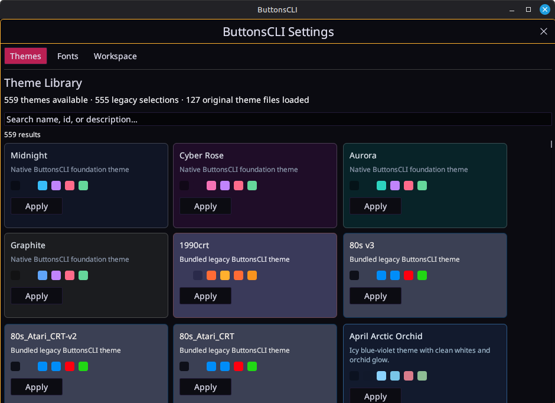

# Themes

A theme sets the app's colors, the terminal's colors, fonts, the background
gradient and special effects (scanlines, noise, shaders). There are hundreds
built in, and you can make your own.

Open **Settings → Themes**. It has four tabs:

| Tab | For |
| --- | --- |
| **Library** | Browsing and applying themes, favorites, theme bundles |
| **Edit** | Changing colors, gradients and effects of a theme |
| **Generate** | Making a theme from a description with AI ([AI themes](ai-themes.md)) |
| **Shaders** | The animated background ([Shader backgrounds](shaders.md)) |

<!-- IMAGE: theme-library.png — Library tab with search, favorites row and Apply to shared checkboxes. -->

## Whole app or one pane

- **Shared theme**: clicking a theme in the Library applies it to the app and
  to every pane that doesn't have its own theme.
- **One pane**: right-click a pane → **Random theme** or a favorite, or use
  **Edit for: Pane N** (below). That pane keeps its look while the shared
  theme changes.
- **Use global theme** on a pane's menu removes its own theme again.

### Apply to shared

Above the list, **Apply to shared** decides which parts of a theme you take:
**App chrome**, **Terminal colors**, **Fonts**, **Gradients** and
**Special effects**. Untick Fonts, for example, to try color themes without
losing your font setup. Shaders count as Special effects.

## Favorites and random

Click the star next to a theme to favorite it. Favorites appear at the top of
the Library and in the status bar's **Favorite themes** menu. **Random theme**
picks one you are not already using.

## Edit for: All panes / Pane 1 / Pane 2…

When two or more panes are on screen, the Edit and Shaders tabs show an
**Edit for** row:

- **All panes** edits the shared theme.
- **Pane N** edits only that pane. Clicking a terminal also switches which
  pane you are editing.

Switching panes never asks you to save: unfinished edits are saved as a new,
numbered personal theme (for example *Ember Veil 2*), so nothing is lost and
no other pane's theme is overwritten.

<!-- IMAGE: edit-for-row.png — the Edit for row with Pane 1–3 chips in their pane colors. -->

## Making your own theme

- **New from current appearance** (Library) captures what you see now.
- In **Edit**, **New variant** starts a copy of the current theme; saving
  writes a personal theme file.
- **Edit raw theme file…** opens the JSON if you like editing text.
- Themes import and export as `.json` files, so you can share them.

<!-- IMAGE: theme-editor.png — Edit tab with the ANSI palette and gradient controls. -->

## Fonts

**Settings → Fonts** sets fonts separately for the terminal, tabs, docks and
the rest of the UI. A pane can also have its own terminal font. Bundled fonts
work offline; you can import TTF/OTF files too.

## Calm

The **Calm** button next to a theme in the Library applies it without
animation or noise: shaders become a still picture. Good for screen sharing or
long sessions.
