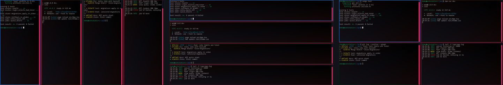
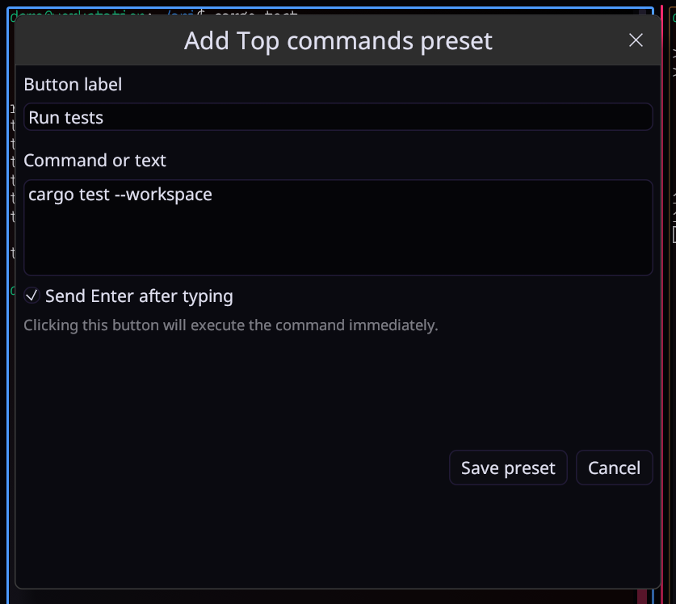

# Workspace and buttons

## Tabs and panes

Every tab is a running terminal. Up to ten are shown at once as **panes**; the
rest keep running in the background.

- **Click a tab that is on screen** to type in it.
- **Click a tab that is off screen** to swap it into the pane you are using.
- **Layouts:** COL, ROW and GRID in the status bar. Drag the dividers to resize.
- **Pane numbers** (Pane 1, Pane 2…) are screen positions, not terminals. Each
  position has its own color on its tab and border, so you can tell them apart.
- **Tab groups:** save the set of open terminals under a name and reopen it
  later from the tab menu.

<!-- IMAGE: layouts.png — the same four terminals as COL, ROW and GRID, side by side. | alt: The same four terminals in the COL, ROW and GRID layouts, side by side -->

## Command buttons

A button pastes a command into the active terminal. Optionally it also presses
Enter for you.

1. Click **+ Add command preset** at the end of the command dock.
2. Give it a label and the command text.
3. Choose **Send Enter after typing** if it should run straight away, or
   **Types only** to check it first.

The SSH dock works the same way for server connections. Docks can resize,
collapse and auto-hide.

<!-- IMAGE: button-editor.png — the preset editor with label, command and Send Enter after typing. | alt: The Add preset window: button label Run tests, command cargo test and Send Enter after typing ticked -->

## Right-click menus

| On… | You get |
| --- | --- |
| A pane | Favorite themes, Random theme, Use global theme, copy, **Paste**, select all, clear screen, rename, **Reset mouse mode** (only while a program uses the mouse), auto-tile, close, and a **Shader** section (Strength, background color, use a shader) |
| A tab | Rename, move left/right, auto-tile, close |
| A button | Run, edit, delete |

Pane actions apply to the pane you right-clicked, even if another one has
keyboard focus.

## Mouse and scrolling

- The wheel scrolls the pane's history, three lines per notch.
- When a program asks for the mouse (tmux, Vim with `mouse=a`, Claude Code,
  Codex), the wheel and clicks go to that program instead. Hold **Shift** to
  scroll or select locally anyway, as in Alacritty.
- Full-screen programs that don't use the mouse (`less`, `man`) get arrow
  keys from the wheel, so they scroll too.
- Pasted text has control characters removed, so a paste can't run hidden
  commands. Line breaks and tabs are kept.

## New versions

When a newer ButtonsCLI release is out on GitHub, a green **⬆ vX.Y.Z
available** link appears in the status bar next to SHELL READY. Clicking it
opens the release page in your browser; nothing is downloaded or installed
for you. The app asks GitHub once each time it starts. To stop that, untick
**Check GitHub for a new release at startup** in Settings → Workspace.

## Settings while you work

### Developer notices

You can opt in to **Receive signed developer notices** during setup or in
Settings → Workspace. These are short status-bar messages or closeable windows
from the ButtonsCLI developer, for security notices and product news. Promotions
and paid feature offers have a separate switch and start off disabled.

Notices are checked at startup and every six hours while the app is open.
Only messages signed with a trusted developer key are shown. You can dismiss each
message, turn the channel off, or set `BUTTONSCLI_NO_ANNOUNCEMENTS=1`.
Links open only when clicked; nothing is installed. The host at buttonscli.com
sees your IP address, but receives no terminal content or profile identifiers.

### Detached Settings

Open Settings detached (its own window) and you can keep typing in the
terminals. Changes preview live. **Revert and Close** undoes everything since
you opened it.
